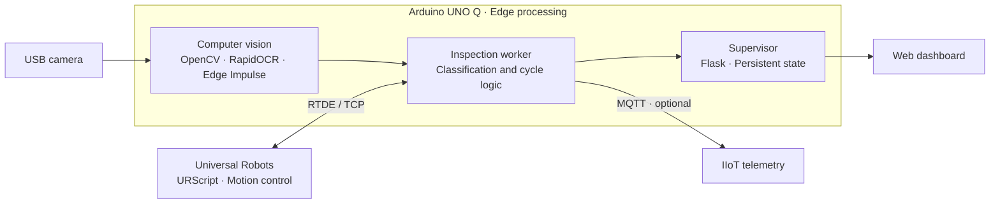
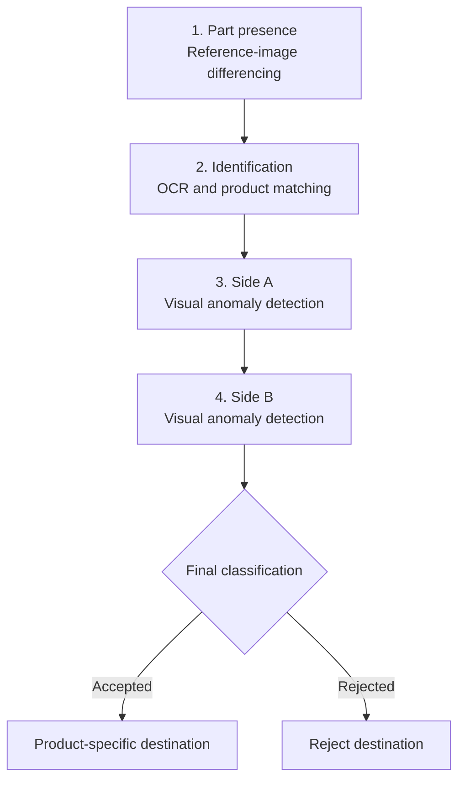

# DIP Inspection

**Embedded AI for visual quality inspection and robotic sorting of integrated circuits.**

DIP Inspection is an industrial automation demonstrator developed at UniSENAI-SP, Campus Vila Mariana, for Futurecom 2026. It integrates an Arduino UNO Q, a USB camera and a Universal Robots collaborative robot to identify and inspect dual in-line package (DIP) integrated circuits and sort them according to their type and visual condition.

The system combines classical computer vision, optical character recognition (OCR), AI-based anomaly detection and industrial communication in a single edge computing application. Image processing and inference run locally on the UNO Q, without relying on a remote inference server.

## Technologies

| Technology | Application |
| --- | --- |
| Arduino UNO Q / Qualcomm Dragonwing | Linux-based edge computing and local inference |
| Python | Application logic, process orchestration and system integration |
| OpenCV | Image acquisition, preprocessing and part presence detection |
| RapidOCR | Integrated circuit marking recognition and identification |
| Edge Impulse | Visual anomaly detection on two inspection views |
| Universal Robots / URScript | Robotic handling and physical sorting |
| RTDE over TCP/IP | Bidirectional synchronization between the robot and the edge device |
| Flask, HTML, CSS and JavaScript | Local monitoring and administration dashboard |
| MQTT | Optional robot telemetry for IIoT integration |
| Linux / systemd | Application deployment and process management |

## System architecture

The robot-side program coordinates physical handling and requests inspection stages through RTDE. The UNO Q processes each request and returns inspection results and the sorting destination. The application separates the inspection worker from the web supervisor, keeping camera acquisition, inference and communication independent of the dashboard.

## Inspection pipeline

- **Presence detection:** identifies whether a component is available on the feed rail using grayscale image differencing, thresholding and morphological filtering.
- **Part identification:** extracts markings with RapidOCR and matches the recognized part number against an enabled product catalog.
- **Quality inspection:** evaluates two views using independent Edge Impulse models with configurable anomaly thresholds.
- **Robotic sorting:** communicates the final classification and destination through RTDE registers; the robot-side program executes the physical movements.
- **Supervision:** provides live camera preview, inspection status, configurable products and thresholds, classification history and optional MQTT telemetry.

## Software organization

| Directory | Responsibility |
| --- | --- |
| [`dip_inspection/core/`](dip_inspection/core/) | Inspection lifecycle, application state, configuration and web supervisor |
| [`dip_inspection/vision/`](dip_inspection/vision/) | Camera, presence detection, OCR and anomaly inference |
| [`dip_inspection/integrations/`](dip_inspection/integrations/) | RTDE, MQTT and network interfaces |
| [`tools/`](tools/) | Dataset collection and camera/vision diagnostics |
| [`deployment/`](deployment/) | Linux service configuration |
| [`tests/`](tests/) | Hardware-independent tests |

## Technical documentation

- [Architecture and inspection interfaces](docs/architecture.md)
- [Illustrative URScript handshake](docs/urscript.md)
- [Deployment and diagnostics](docs/deployment.md)
- [Research assets](docs/reproducibility.md)

## Academic context

This repository accompanies the study *Desenvolvimento e avaliação de um sistema de inspeção visual baseado em IA embarcada para triagem robotizada de circuitos integrados DIP*.

It presents the software architecture and implementation of a physical industrial inspection demonstrator, with emphasis on Edge AI, machine vision, robotic integration and Industrial IoT. The source is provided as a technical reference; the trained models, dataset, complete robot program and station-specific calibration are not distributed here.

## License

Source code is available under the [MIT License](LICENSE). Third-party dependencies retain their respective licenses.
