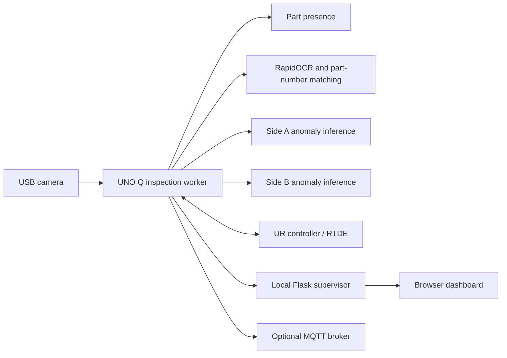

# DIP Inspection

Edge-based visual inspection and robotic sorting of dual in-line package (DIP) integrated circuits using an Arduino UNO Q and a Universal Robots controller.

Developed as an industrial inspection demonstrator for Futurecom 2026 at UniSENAI-SP, Campus Vila Mariana. The application combines classical computer vision, optical character recognition (OCR), and visual anomaly detection on the edge device. Robot movements are managed by a separate robot-side program.

## System overview



The robot requests inspection stages through RTDE. The UNO Q captures images, evaluates the requested stage, and returns the result. The final sorting destination depends on a recognized and enabled part number and two accepted side inspections. The application does not generate robot trajectories.

| Stage | Method |
| --- | --- |
| Presence | Grayscale reference-image differencing, Gaussian blur, thresholding and morphological filtering |
| Identification | RapidOCR, heuristic candidate ranking, exact matching against the enabled product catalog |
| Side A / B | Two Edge Impulse inference executables; mean visual anomaly score compared with side-specific thresholds |
| Sorting | RTDE integer registers; destinations 1–4 for enabled products, 5 for rejects |
| Monitoring | Local dashboard, persistent classification history and optional MQTT robot telemetry |

## Repository structure

| Path | Purpose |
| --- | --- |
| `main.py` | Station entry point |
| `dip_inspection/core/` | Supervisor, inspection worker, configuration, state, product catalog, dashboard assets |
| `dip_inspection/vision/` | Camera acquisition, presence detection, OCR and anomaly inference |
| `dip_inspection/integrations/` | RTDE, MQTT and Wi-Fi interfaces |
| `tools/` | Dataset collection, camera/OCR and presence diagnostics |
| `deployment/` | Optional systemd service and Wi-Fi helper |
| `tests/` | Hardware-independent tests |
| `models/`, `docs/` | Model requirements and technical documentation |

## Quick start

Requirements: Arduino UNO Q running Linux, a compatible USB camera, Python 3 with a virtual environment, a Universal Robots controller with a compatible robot-side RTDE program, and both Edge Impulse model exports. A local MQTT broker is optional.

From the repository root:

```sh
python3 -m venv .venv
. .venv/bin/activate
python -m pip install -r requirements.txt
cp settings.example.json settings.json
cp products.example.json products.json
cp deployment/futurecom.env.example deployment/futurecom.env
chmod 600 settings.json deployment/futurecom.env
```

1. Set the actual robot IP, camera and MQTT settings in `settings.json`. The example robot address is a documentation placeholder. Review the product-to-destination mapping.
2. Supply `models/side_a.eim` and `models/side_b.eim` and make them executable.
3. Prepare the local RapidOCR model cache before offline operation.
4. With the station stopped and the robot in its empty-rail inspection pose, capture and validate a reference image:

   ```sh
   python -m tools.test_presence --capture --reference empty_reference.jpg
   python -m tools.test_presence --reference empty_reference.jpg --samples 30
   ```

5. Generate an administrator password hash and set `FUTURECOM_ADMIN_HASH` in `deployment/futurecom.env` (see [deployment](docs/deployment.md)). Then start the supervisor:

   ```sh
   set -a
   . deployment/futurecom.env
   set +a
   python main.py
   ```

Open `http://<UNO-Q-IP>:5000` on the station network. The worker is not started automatically in the example configuration; use the authenticated dashboard after commissioning the station.

## Documentation and reproducibility

- [Inspection pipeline and RTDE interface](docs/architecture.md)
- [Illustrative robot-side URScript handshake](docs/urscript.md)
- [Deployment and diagnostics](docs/deployment.md)
- [Research assets and reproduction checklist](docs/reproducibility.md)

Run hardware-independent tests with:

```sh
python -m unittest discover -s tests -t . -v
```

The dashboard and runtime messages retain the original Portuguese localization. Code documentation is in English. The example configuration records the side thresholds from the supplied station snapshot, not a universal calibration.

## Citation and availability

This repository is intended as a software companion to the study *Desenvolvimento e avaliação de um sistema de inspeção visual baseado em IA embarcada para triagem robotizada de circuitos integrados DIP*. Add the verified bibliographic citation, DOI (if assigned), and a tagged software release when the publication details and release are finalized.

The trained model binaries, robot-side program, calibration reference and dataset are not included in the main source distribution. See the reproducibility checklist for their roles and availability. The source code is released under the [MIT License](LICENSE). Third-party dependencies and external research assets retain their own licensing terms.
